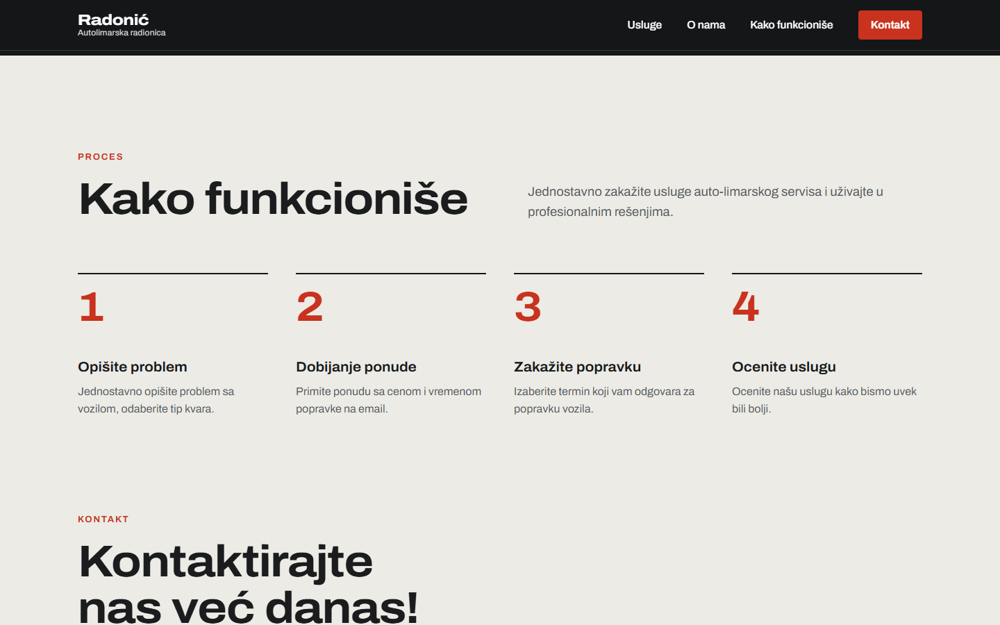
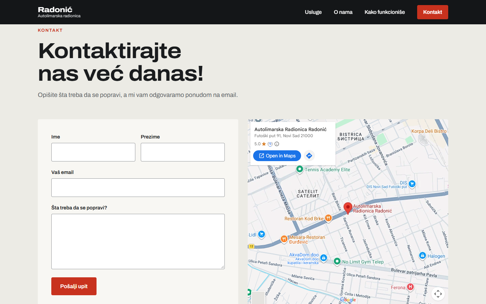
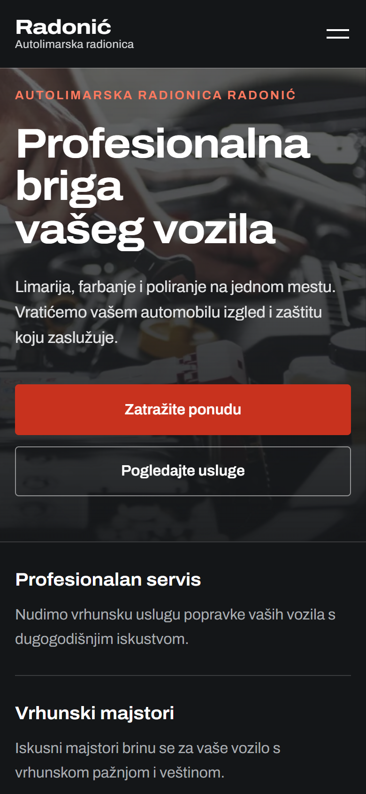

# Autolimarska radionica Radonić

Website for an auto body repair shop in Novi Sad: services, how the process works, location, and a contact form that emails enquiries to the shop. The site is in Serbian.

## Screenshots


| Services | About |
|----------|-------|
|  |  |

| How it works | Contact |
|--------------|---------|
|  |  |

<p align="center"></p>

## Tech stack

- **Frontend:** Angular 15
- **Server:** Node.js and Express (`server/index.js`) serve the built site and handle the contact form
- **Email:** Resend HTTP API, or SMTP through Nodemailer

## Getting started

Requires Node.js 18 or newer.

```bash
git clone https://github.com/IgorPavlov00/AutoRepairShop.git
cd AutoRepairShop
npm install
```

For development, run the API and the Angular dev server in two terminals. `proxy.conf.json` is there to forward API calls to the server on port 4242.

```bash
npm run serve   # Express on http://localhost:4242
npm start       # Angular on http://localhost:4200
```

To run the production build locally:

```bash
npm run build
npm run serve
```

## Email configuration

The contact form reads its settings from environment variables, listed in `.env.example`. Never commit real values.

| Variable | Purpose |
|----------|---------|
| `MAIL_TO` | Address that receives contact form messages (required) |
| `RESEND_API_KEY` | Resend API key, the recommended option |
| `MAIL_FROM` | Sender address (optional) |
| `SMTP_HOST`, `SMTP_PORT`, `SMTP_USER`, `SMTP_PASS` | SMTP alternative to Resend |

Without a verified domain, Resend only delivers to your own Resend account's address. If email isn't configured, the site still runs but the form returns a 503 error.

## Deployment

`render.yaml` defines a Render Blueprint: a free Node web service in Frankfurt with a `/healthz` health check. Create the Blueprint from this repository, then enter `MAIL_TO` and `RESEND_API_KEY` when prompted. Render's free plan blocks outbound SMTP, so use Resend there.
